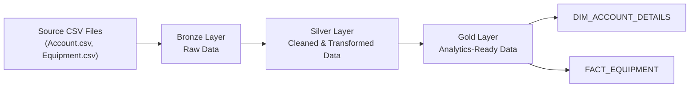
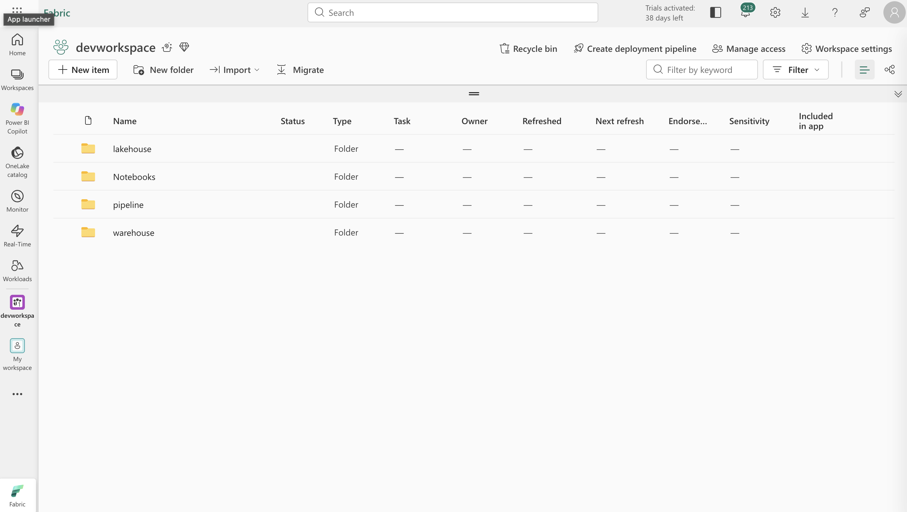
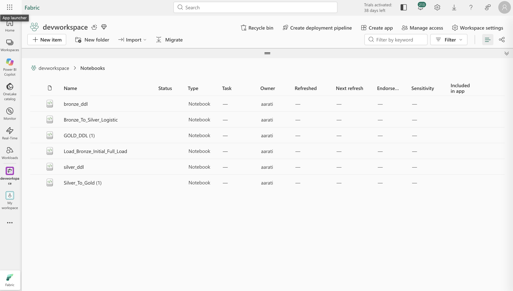
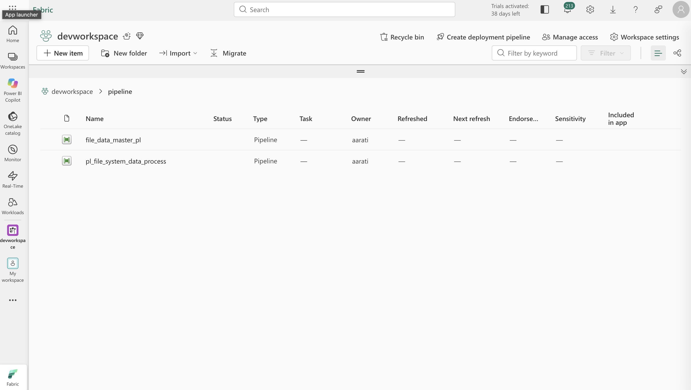
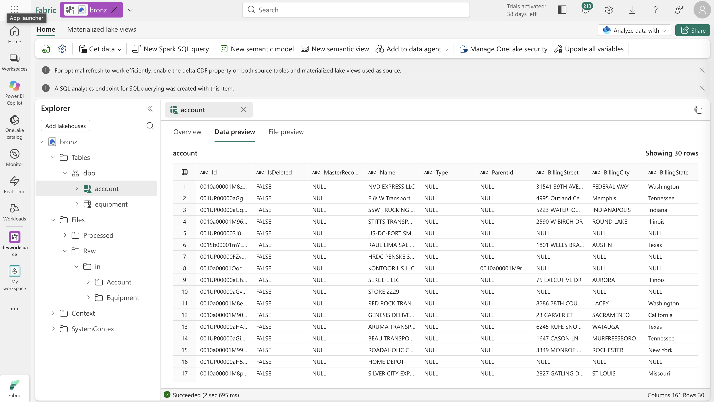
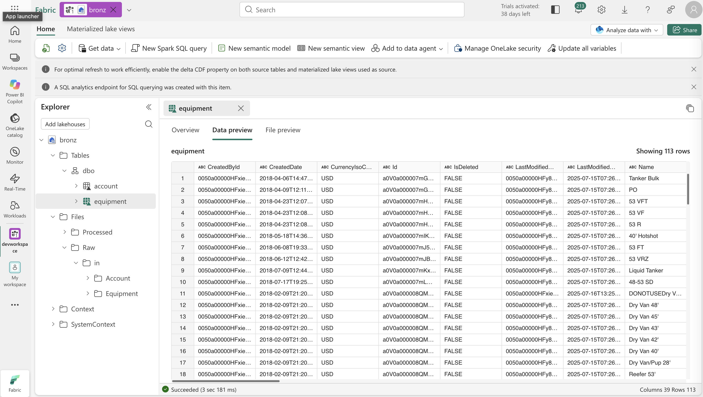
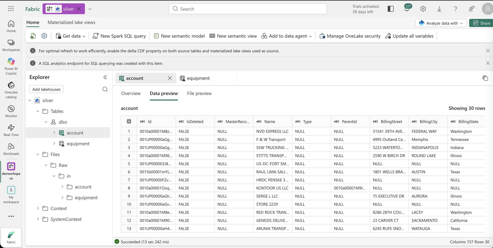
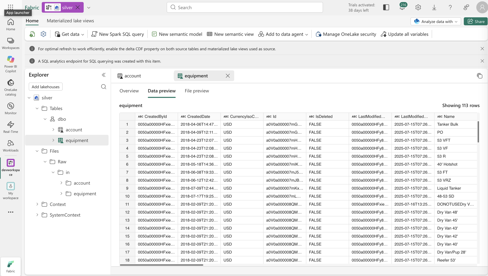
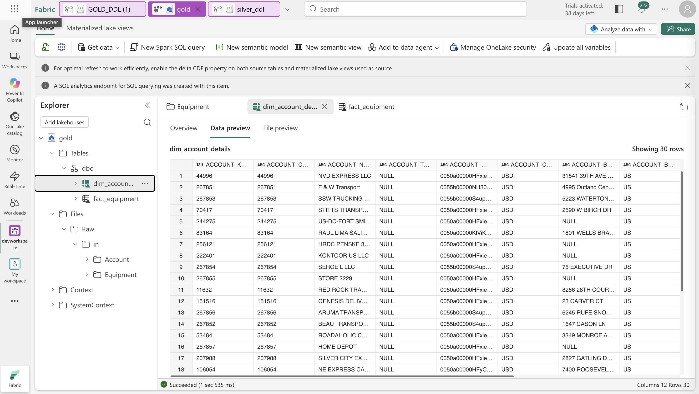
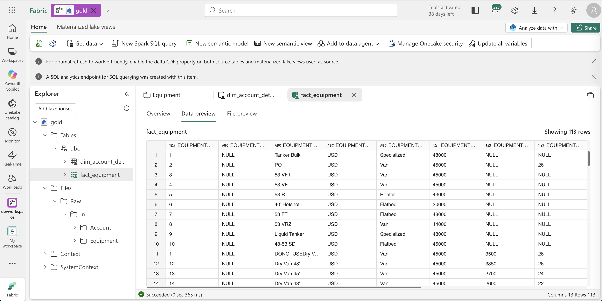

### Logistics Data Engineering Project – Microsoft Fabric

### 📌 Project Overview

This project showcases an end-to-end Logistics Data Engineering solution developed using **Microsoft Fabric**. It demonstrates how raw logistics data can be ingested, processed, transformed, and structured into analytics-ready datasets using the **Medallion Architecture (Bronze, Silver, and Gold)**.

The solution uses Microsoft Fabric Lakehouses, Notebooks, Pipelines, and Warehouse components to implement a structured data processing workflow.

### 🎯 Project Objectives

- Ingest raw logistics data into the Bronze layer.
- Clean, validate, and transform data in the Silver layer.
- Build structured dimension and fact tables in the Gold layer.
- Implement an organized and scalable data processing workflow.
- Leverage Microsoft Fabric notebooks and pipelines for data transformation and orchestration.

### 🏗️ Project Architecture

The solution follows the **Medallion Architecture**, separating data processing into three layers:

**Bronze → Silver → Gold**



### Data Processing Layers

- **Bronze Layer:** Stores raw Account and Equipment source data while maintaining the original data structure.
- **Silver Layer:** Performs data cleansing, column mapping, null handling, and data type conversions to improve data quality.
- **Gold Layer:** Organizes processed data into dimension and fact tables to support analytical reporting and business insights.

### 🛠️ Technologies & Tools

- Microsoft Fabric
- PySpark
- SQL
- Microsoft Fabric Lakehouse
- Microsoft Fabric Warehouse
- Fabric Notebooks
- Fabric Data Pipelines
- Medallion Architecture

### 🔄 Implementation Workflow

1. Set up the Microsoft Fabric workspace and required project components.
2. Created configuration tables to manage source objects and ingestion requirements.
3. Ingested Account and Equipment CSV files into the Bronze layer.
4. Applied data cleaning and transformation logic to load data into the Silver layer.
5. Created and populated Gold dimension and fact tables.
6. Organized the end-to-end data processing workflow using Fabric notebooks and pipelines.

### 📊 Data Objects

| Layer | Data Objects |
|---|---|
| Bronze | Account, Equipment |
| Silver | Account, Equipment |
| Gold | DIM_ACCOUNT_DETAILS, FACT_EQUIPMENT |

### 📸 Project Screenshots

### 1. Workspace Overview



### 2. Notebooks Overview



### 3. Pipelines Overview



### 4. Bronze Layer 

**Account Table**



**Equipment Table**



### 5. Silver Layer 

**Account Table**



**Equipment Table**



### 6. Gold Layer 

**Dimension Table – DIM_ACCOUNT_DETAILS**



**Fact Table – FACT_EQUIPMENT**



### 📈 Project Output Summary

The following table summarizes the record counts across the three processing layers.

| Layer | Account Records | Equipment Records |
|---|---:|---:|
| Bronze | 30 | 113 |
| Silver | 30 | 113 |
| Gold | 30 | 113 |

### 📁 Repository Structure

```text
Logistics_Project/
│
├── Lakehouses/
│   ├── Bronze/
│   ├── Silver/
│   └── Gold/
│
├── Notebooks/
│   ├── bronze_ddl
│   ├── Load_Bronze_Initial_Full_Load
│   ├── Bronze_To_Silver_Logistic
│   ├── silver_ddl
│   ├── GOLD_DDL
│   └── Silver_To_Gold
│
├── Pipelines/
│   └── Data Processing Pipelines/
│
└── Warehouse/
    └── DW/
```

### 🎓 Key Learnings

Through this project, I gained practical experience in:

- Implementing Medallion Architecture using Microsoft Fabric.
- Ingesting raw CSV datasets into a Bronze Lakehouse.
- Applying data cleansing and transformation techniques using PySpark.
- Managing structured data across Bronze, Silver, and Gold layers.
- Designing dimension and fact tables for analytical use cases.
- Working with Microsoft Fabric Notebooks, Lakehouses, Warehouses, and Pipelines.
- Understanding end-to-end data engineering workflows.


  👩‍💻 Author

Aarati Tathe

[LinkedIn Profile](https://www.linkedin.com/in/aarati-tathe-7549b7263/)

---

